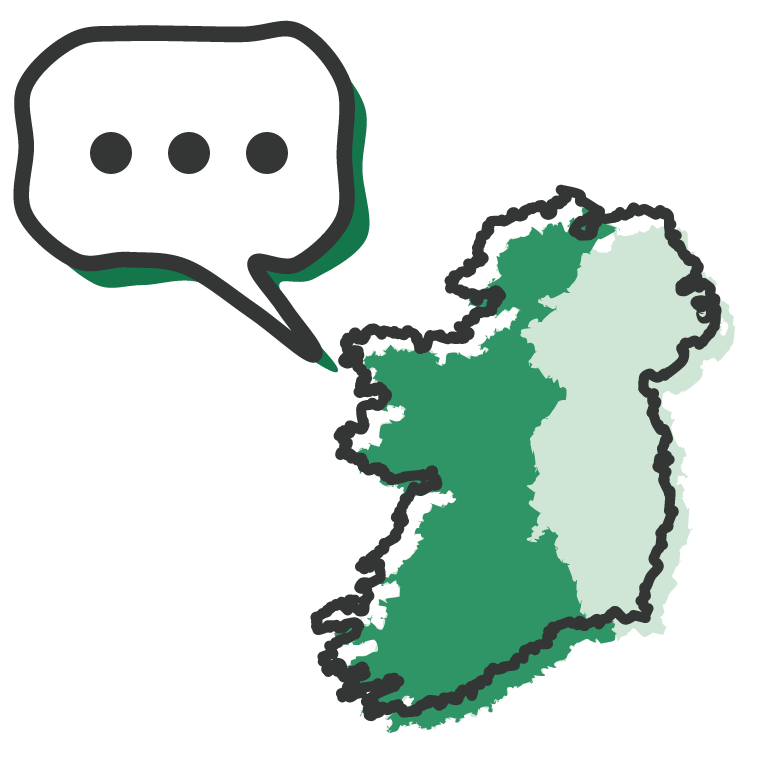

<p align="center">
  
</p>

# Where did the Irish language go?

A hand-drawn, scrolling story of who could speak Irish in each of Ireland's 32 counties, in every census from 1851 to 2022.

**Live:** https://irishlanguagemap.org/

##  What's in it

- **The story:** scroll from 1851 to today: where Irish was strong, how it fell, and how it spread out again, with maps, charts and short notes on the history.
- **Your county:** guess its 1851 figure, then watch its whole history draw in.
- **Every census:** drag a timeline through all the years and tap any county.
- **Phones first:** it steps through the story one screen at a time on touch screens.

##  Support

If you enjoy it, you can [buy me a coffee](https://buymeacoffee.com/acoci86).

##  Data

- **Republic of Ireland:** Central Statistics Office ([data.cso.ie](https://data.cso.ie/)).
- **Northern Ireland:** the Northern Ireland censuses, compiled by [Phelim Birch](https://bsky.app/profile/phelimbirch.bsky.social).
- **Boundaries:** Ordnance Survey Ireland and Ordnance Survey of Northern Ireland, simplified with [mapshaper](https://github.com/mbloch/mapshaper).

The figures are self-reported ability, and the census questions changed over time. The [methodology page](https://irishlanguagemap.org/methodology.html) covers the caveats and the sources for the history.

##  Run it

Needs [Node.js](https://nodejs.org/) 18 or newer.

```bash
npm install
npm start        # http://localhost:3000
npm run build    # static site in dist/
```

Pushes to `main` are built and deployed to GitHub Pages by [`.github/workflows/pages.yml`](.github/workflows/pages.yml).

Built with Express and EJS, D3, rough.js, RoughNotation, Leaflet and GSAP; the drawings were made in VectorCraft.

Everything the page needs is served from the site itself: the libraries are in [`public/vendor`](public/vendor) and the two handwriting fonts (Gaegu and Patrick Hand, SIL Open Font Licence) in [`public/fonts`](public/fonts), so a blocked or down third-party server can't break it. The libraries keep their own licences (Leaflet BSD-2, D3 ISC, rough.js and RoughNotation MIT, GSAP under GreenSock's licence).

##  Thanks

To [Phelim Birch](https://bsky.app/profile/phelimbirch.bsky.social), who compiled the Northern Ireland figures for his degree project and generously shared them. Without his work the map would stop at the border.

##  License

MIT, see [LICENSE](LICENSE). Census data © CSO and NISRA; boundaries © OSi and OSNI, under their open-data terms.

Heading icons are from [SerenityOS](https://github.com/SerenityOS/serenity) (BSD 2-Clause), except the smiley, which is drawn in the same style.
